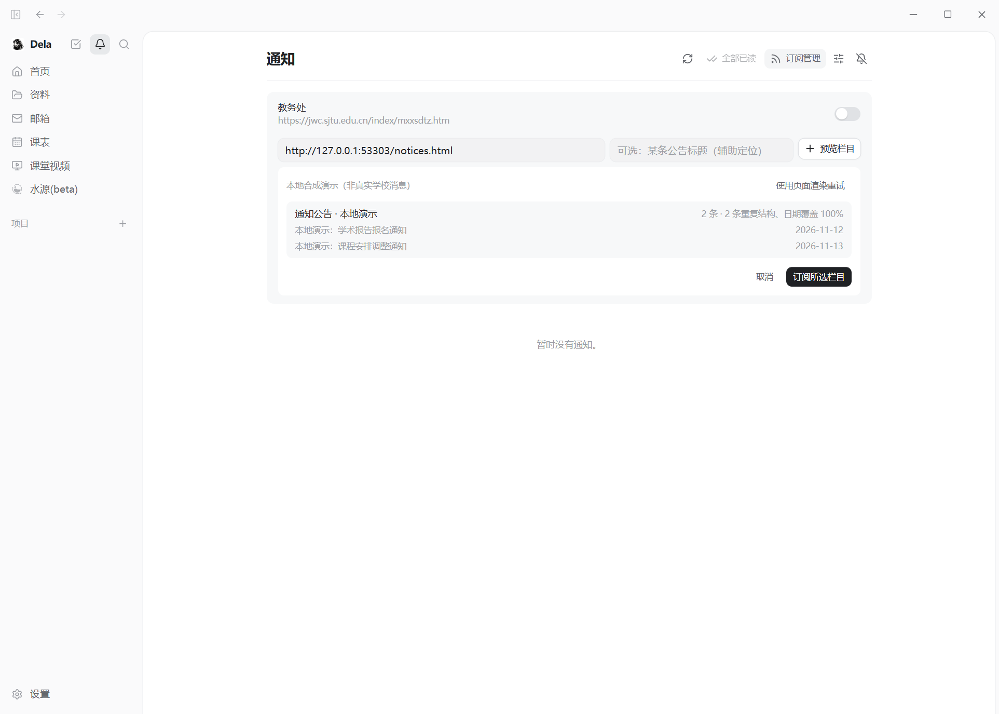
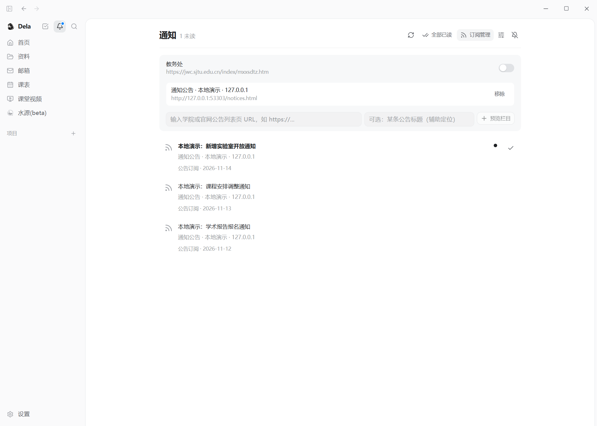

# 通用官网公告订阅框架

关联 [Issue #185](https://github.com/Chang-Yo/Dela/issues/185)。用户输入公开 URL，确认要订阅的栏目后，保存规则并发现新增公告。解析核心位于 `experiments/notice-subscriptions/`，通过 `src/main/notifications/notices.ts` 宿主适配层接入 Dela 通知中心与通知页订阅管理（受试验功能开关控制）；内置教务处通知保留独立开关及正文、验证码附件能力。登录、验证码、自动分页及 #127 的兴趣筛选和 TODO 联动不在通用订阅范围内。

框架首先服务消息源接入开发者，通过规则复用和 B+ 宿主汇聚兼容降低接入成本，目标是让学生像关注公众号一样自主选择官网消息源，减少信息差。专用解析器仍由开发者独立实现，再通过宿主适配层汇入通知中心。

## 原理

1. 获取公开 HTML 或 RSS/Atom；动态页面由用户显式启用隔离 Electron 渲染。
2. 根据重复 DOM 结构、标题、链接、日期和栏目上下文生成候选，排除导航、分页及认证操作链接。用户选择目标栏目，单条栏目可用完整标题辅助定位；核心没有学院目录或逐站选择器。
3. 将确认的栏目结构保存为规则，首次建立已见 URL 的静默基线。刷新重放同一规则，按 URL 身份返回新增条目；标题修改、置顶或重排不重复返回。
4. 日期缺失或非法时保留 `null`，日粒度保留日期，带明确时区的时间转为 UTC。规则明显失配时要求重新确认，失败刷新不更新状态。
5. 宿主层将通用订阅与既有教务处来源汇入同一通知中心，保留既有解析路径、历史去重与已读状态；当前兼容发生在宿主汇聚层。

运行方式见[实验 README](../experiments/notice-subscriptions/README.md)，宿主接口见[框架契约](../experiments/notice-subscriptions/validation/framework/FRAMEWORK_CONTRACT.md)。

## 测试

覆盖未知页面结构、栏目选择、规则重放、首次基线、新增去重、失败时状态保护、RSS/Atom、日期校验及显式渲染；宿主回归覆盖迁移与历史已读保留、通用订阅和教务处刷新期间的停用保护、重新开启后恢复刷新、主程序与渲染 worker 启动分流。测试输入、标注和评价器均随仓库交付，包括 16 份网页快照和 8 份跨校控制页。

2026-11-14 在 Windows 上验证：

| 检查                                           | 结果                                                     |
| ---------------------------------------------- | -------------------------------------------------------- |
| `pnpm check`：格式、lint、类型、构建及全量测试 | 219 个测试文件，1659/1659 测试通过                       |
| `pnpm check:notices`：完整性与严格验收         | 95 份文件校验、172 个案例和 444 个变形通过验收           |
| `pnpm smoke`：Electron 基础运行                | SQLite、renderer、preload 隔离、Agent ESM、Bash PTY 通过 |
| 真实界面与 preload IPC                         | 首次 2 条已读；增量后 3 条、1 条未读；重复刷新不增加     |

在仓库根目录运行 `pnpm check` 可复验。macOS 和远端 CI 尚未验证。

隔离发布布局验证已复现旧入口错误，并确认修复后的普通应用启动分流；安装版动态渲染仍因本机测试目录权限限制未完成端到端验收。未为通过探针而关闭 Electron 沙箱。

## 解析成功率

以下按正例的严格解析结果统计，要求标题、URL、日期、顺序正确且没有额外条目；负例拒绝不计入解析成功数。

| 集合                 | 正例解析通过数 | 通过率 |
| -------------------- | -------------- | ------ |
| 开发集当前回归       | 112/112        | 100%   |
| 独立确认集首次运行   | 40/44          | 90.9%  |
| 确认集揭盲修复后回归 | 44/44          | 100%   |

当前另有 16/16 个负例被正确拒绝，合计 172/172 个案例通过。444 个变形中，400 个正确解析（90.1%）、44 个明确拒绝、0 异常；拒绝不代表兼容成功。

首次独立确认的总成绩为 44/48，后续 48/48 属于揭盲后的回归。原始结果见[首次确认记录](../experiments/notice-subscriptions/validation/framework/confirmation-first.json)，判分标准见[开发集规范](../experiments/notice-subscriptions/validation/framework/development/SPEC.md)和[确认集规范](../experiments/notice-subscriptions/validation/framework/confirmation/SPEC.md)。语料包含合成案例和公开网页，有限样本不能外推为全校或任意 URL 的成功率。

## 截图实例

以下为实际 Dela 通知页，通过真实 preload IPC 完成订阅操作，使用独立临时 profile 和本地 HTTP 合成公告，不涉及真实账号或学校消息。运行断言见[界面验证记录](../experiments/notice-subscriptions/validation/framework/evidence/ui-run.json)，原框架输入与重放证据保留在[截图目录](../experiments/notice-subscriptions/validation/framework/evidence/)。

预览两个公告，确认要订阅的栏目：

首次保存后两条历史公告均已读；新增第三条公告后，仅新增一条未读通知。再次刷新仍为三条公告、一条未读：

